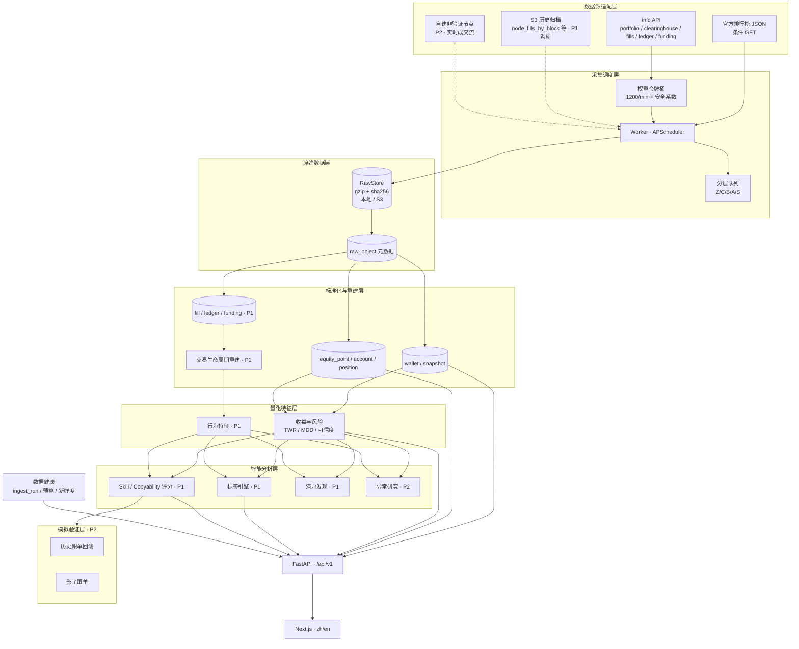
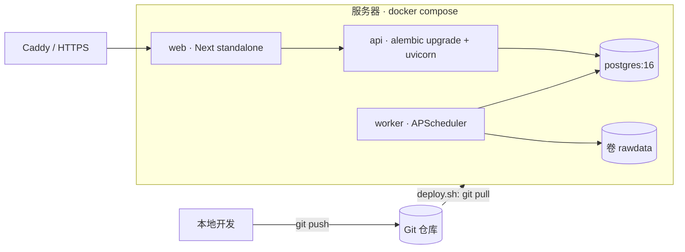

# 02 · 系统架构

## 1. 总体分层

实线是 P0 已实现的部分，虚线和标注 P1/P2 的部分是规划。

## 2. 技术选型

| 层 | 选择 | 理由 | 何时升级 |
|---|---|---|---|
| 后端语言 | Python 3.11 | 量化计算生态最好；和研究代码同一语言 | — |
| Web 框架 | FastAPI + Pydantic v2 | 类型化输入校验，自动 OpenAPI | — |
| ORM / 迁移 | SQLAlchemy 2 + Alembic | 迁移版本化；复杂查询直接用 SQL | — |
| 调度 | APScheduler（单进程 worker） | 当前任务量小，单进程最简单可靠 | 任务种类多或需要横向扩展时，换成 Postgres 队列（如 procrastinate）或 Dramatiq |
| 主库 | PostgreSQL 16 | 关系 + JSONB + 数组 + GIN，足以支撑百万到亿级行 | `leaderboard_row` / `fill` 过亿行时按月分区；分析吞吐成为瓶颈时引入 ClickHouse 或 Parquet + DuckDB |
| 时序 | 暂不使用 TimescaleDB | P0 数据量下原生分区足够 | fill / candle 量级上来后评估 |
| 缓存 | 暂不引入 Redis | 排行榜查询 < 200ms，无需缓存 | 并发用户多时缓存排行榜页 |
| 原始归档 | 本地文件系统（RawStore 接口） | 开发简单；接口可以替换 | 部署后切换到 S3 兼容存储 |
| 前端 | Next.js 15 App Router + next-intl + Tailwind 4 + ECharts | 服务端渲染适合数据密集页面；URL 驱动的筛选可分享 | K 线回放类功能加 TradingView Lightweight Charts |
| 消息队列 | 不引入 Kafka | 没有必要 | 自建节点产生实时成交流时再评估 |

## 3. 采集与成本控制

**分层采集**（规则版本 `t1`，见 `backend/app/tiering.py`）：

| 层 | 规模（实测） | 采集内容 | 频率 | 每日权重 |
|---|---|---|---|---|
| Z 冷库 | 18,707 | 排行榜行 | 随排行榜 | 0 |
| C 基础 | 15,019 | 排行榜行 | 随排行榜 | 0 |
| B 初筛 | 13,998 | portfolio + clearinghouse | 每 7 天一轮 | 约 44k |
| A 深度 | 上限 2–3k（P1） | + fills / ledger / funding / historicalOrders / subAccounts | 每日增量 | 约 300–500k |
| S 实时 | ≤ 50（P2） | 成交轮询 | 每 1–5 分钟 | 视数量 |

**成本控制要点**

- 排行榜用 `If-None-Match`，内容没变时返回 304，不下载（已实现）。
- 同样内容（sha256 相同）不重复入库（已实现）。
- 排行榜宽表快照每 6 小时才写一次，其余每小时只更新 `wallet` 的最新值（已实现）。
- 所有 API 请求经过权重令牌桶；响应条数带来的附加权重在请求后补扣（已实现）。
- A 层回填优先级 = 初筛评分 × 潜力信号 × 观察清单，**绝不按原始 ROI**。
- 指标只在新数据到达时重算（portfolio 刷新后才重算 wallet_metric）。
- 历史批量分析与实时监控分开运行（P2 起 worker 拆成 batch / live 两个进程）。

## 4. 时间点一致性（防未来函数）

1. 每个原始响应写入 RawStore（gzip），`raw_object` 记录 `fetched_at`、`sha256`、请求参数、ETag。
2. 标准化表保存 `fetched_at` 或快照 ID，不覆盖历史：`leaderboard_row` 按快照追加，`equity_point` 追加且主键为 `(wallet, series, ts)`，`account_snapshot` 按采集时间追加。
3. 评分、标签、名单都带版本号，并记录计算时使用的数据截止时间（P1 起 `as_of` 字段）。
4. 回测只允许读取 `fetched_at <= 模拟时点` 的数据。
5. `wallet` 表上的"最新值"字段只是查询缓存，可以随时从快照重建。

## 5. 运行与部署

- 开发：本机 PostgreSQL + `make api / web-dev / worker`。
- 生产：`docker compose`；API 容器启动时执行迁移；worker 等 API 健康后启动；只有 web 通过反向代理对外。
- 监控：`/api/v1/data-health` 汇总最近任务、成功时间、API 预算使用、表规模、原始归档大小；被中断的任务会被自动标记为 `abandoned`。P1 增加告警（采集超过 3 小时未成功、Schema 失败、预算超 80%）。

## 6. 资源需求

| 环境 | 配置 | 说明 |
|---|---|---|
| 开发 | 本机 | P0 实测：一次全量导入约 22 秒；数据库约 100 MB |
| 生产 P0–P1 | 4 vCPU / 16 GB / 100 GB SSD | 一年 `leaderboard_row` 约 7,000 万行（约 10 GB），A 层成交约数千万行 |
| 生产 P2 | + 自建节点（规格按官方要求） + 对象存储 | 实时影子跟单与全网成交发现 |
