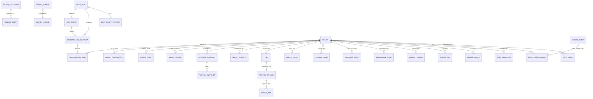

# 03 · 数据模型

P0 只创建实际会写入数据的表（迁移 `backend/alembic/versions/0001_init_p0_schema.py`）。其余实体先在这里设计，到对应阶段再建表。

## 1. 分层

| 层 | 说明 | 示例 |
|---|---|---|
| 原始层 | 上游响应原样归档，不可修改 | `raw_object` + RawStore 文件 |
| 标准化层 | 解析后的事实，按采集时间追加 | `leaderboard_row`、`equity_point`、`fill` |
| 重建层 | 由事实推导出的交易结构 | `position_episode`、`round_trip` |
| 研究层 | 指标、标签、评分、名单（带版本） | `wallet_metric`、`trader_tag`、`trader_score` |
| 展示层 | 为查询准备的冗余字段 / 物化视图 | `wallet` 的最新值字段、`ranking_snapshot` |

## 2. ER 图

## 3. P0 表（已建）

| 表 | 主键 / 唯一约束 | 关键字段 | 索引 | 写入方式 |
|---|---|---|---|---|
| `ingest_run` | `id` | kind, status, started_at, finished_at, stats(JSONB), error | (kind, started_at) | 每次任务一行；中断的任务会被标记为 `abandoned` |
| `raw_object` | `id` | source, request(JSONB), fetched_at, storage_path, sha256, size_bytes, etag, last_modified | source, fetched_at, sha256 | 追加 |
| `wallet` | `id`；`address` 唯一 | first_seen_at/source, last_seen_at, present_in_latest, removed_at, 最新排行榜 13 个数值, quality_flags[], tier, enrichment_flags[], portfolio_fetched_at | GIN(quality_flags), first_seen_at, month_pnl, account_value, tier | upsert；`first_seen_*` 永不覆盖 |
| `leaderboard_snapshot` | `id` | fetched_at, source_last_modified, row_count, rows_persisted | fetched_at | 每次内容变化一行 |
| `leaderboard_row` | (snapshot_id, wallet_id) | 同 wallet 的 13 个数值 + quality_flags | (wallet_id, snapshot_id) | 每 6 小时整表追加 |
| `wallet_tier_history` | `id` | tier, previous_tier, rule_version, assigned_at | wallet_id | 只在层级变化时追加 |
| `equity_point` | (wallet_id, series, ts) | account_value, pnl, fetched_at, raw_object_id | PK | 追加，冲突忽略（保留首次观察） |
| `wallet_metric` | (wallet_id, metric_window) | metric_version, computed_at, source_series, covered, span, n_points, n_valid_periods, median_step_hours, twr, mdd, pnl, pnl_mdd_usd, net_flows, positive_period_ratio, reliability, notes[] | (metric_window, twr) | 可重算，upsert（原始点在 equity_point） |
| `account_snapshot` | `id`；(wallet_id, fetched_at) 唯一 | account_value, total_ntl_pos, total_margin_used, withdrawable | (wallet_id, fetched_at) | 追加 |
| `position_snapshot` | `id` | coin, szi, entry_px, position_value, unrealized_pnl, leverage, liquidation_px | account_snapshot_id | 追加 |

数值统一用 `NUMERIC`（保留上游字符串精度），时间统一用 `timestamptz` 并以 UTC 存储（连接级 `timezone=UTC`）。

## 4. 规划中的实体

| 实体 | 阶段 | 主键 / 唯一约束 | 关键字段 | 说明 |
|---|---|---|---|---|
| `wallet_identity` | P1 | (wallet_id, related_wallet_id, relation) | relation: master_of / sub_account_of / vault_leader_of；evidence: api 来源；verified_at | 只记录链上声明的关系，**不根据行为相似性关联** |
| `fill` | P1 | (wallet_id, tid) 唯一 | time, coin, side, px, sz, dir, start_position, closed_pnl, fee, fee_token, oid, crossed, twap_id, hash, raw_object_id | 按月分区；`tid` 去重解决重复采集 |
| `order_event` | P1 | (wallet_id, oid, status_ts) | order_type, tif, trigger, reduce_only, is_position_tpsl, status | 识别止损单、挂单/吃单习惯 |
| `funding_event` | P1 | (wallet_id, time, coin) | usdc, szi, funding_rate | 成本归因 |
| `transfer_event` | P1 | (wallet_id, hash, type) | type: deposit / withdraw / send / subAccountTransfer / vault*; usdc; counterparty | 资金流与起始资金验证 |
| `liquidation_event` | P1 | (wallet_id, time, coin) | 来自 fills 的 liquidation 字段或 ledger | 风险事件 |
| `position_episode` | P1 | `id`；(wallet_id, coin, opened_at) | direction, opened_at, closed_at, max_size, avg_entry, avg_exit, adds, reductions, realized_pnl, fees, funding, complete(bool), incomplete_reason | 仓位从 0 到 0 的完整周期；翻仓拆成两个 episode |
| `round_trip` | P1 | `id` | episode_id, entry/exit legs, holding_time, pnl_net, mae, mfe | 胜率等指标的统计单位 |
| `market_candle` | P1 | (coin, interval, t) | o, h, l, c, v, n, fetched_at | 从现在开始自己记录 1m / 1h |
| `market_regime` | P1 | (coin, t, version) | regime: trend_up / trend_down / range / high_vol / crash | 只用 t 时刻之前的数据计算 |
| `market_event` | P2 | `id`；(name, version) | start, end, coins, category, public_info_time, source, description | 事件定义带版本，防止事后挑选区间 |
| `event_participation` | P2 | (event_id, wallet_id) | lead_time, direction_correct, capture_ratio, abnormality_score, baseline | 事件研究结果 |
| `wallet_feature` | P1 | (wallet_id, feature_set, as_of) | features(JSONB), coverage, sample_size | 特征快照，带数据截止时间 |
| `trader_tag` | P1 | (wallet_id, tag_key, version, valid_from) | confidence, evidence(JSONB), sample_size, coverage, valid_to, status | 见 05；失效时写 valid_to，不删除 |
| `trader_score` | P1 | (wallet_id, model, version, as_of) | total, components(JSONB), confidence, rank_in_peer, reasons[] | 见 04 |
| `ranking_snapshot` / `ranking_entry` | P1 | (ranking_key, as_of) / (snapshot_id, wallet_id) | criteria, rank, score | 名单冻结，用于"名单战绩"回测 |
| `copy_simulation` | P2 | `id` | wallet_id, mode(backtest/shadow), start, capital, latency, cost_model, results(JSONB) | 见 04 第 6 节 |
| `alert_rule` | P2 | `id` | owner, wallet_id/condition, channel, last_fired_at | — |
| `data_quality_report` | P1 | (ingest_run_id, check) | check, severity, affected, details | 例如：fills 与 portfolio PnL 对账差异 |

## 5. 完整性约束与边界处理

| 场景 | 处理 |
|---|---|
| 同一成交被重复采集 | `fill` 唯一键 (wallet_id, tid) + `ON CONFLICT DO NOTHING` |
| 同一订单多次部分成交 | 按 `oid` 聚合成一个执行；统计时以 `tid` 为最小单位 |
| 跨零翻仓（`Long > Short`） | 在 `start_position` 符号翻转处拆分，前一个 episode 关闭、后一个开启，成交量按比例分配 |
| 历史开仓缺失（第一笔成交是平仓） | episode 标记 `complete=false, incomplete_reason='open_before_window'`，不参与胜率计算 |
| 多币种同时持仓 | episode 按 (wallet, coin) 独立 |
| 排行榜文件中地址重复 | 解析时只保留第一条并计数（实测为 0） |
| 上游结构变化 | Schema 校验失败 → 本次任务 `failed`，不写入 |
| 时间戳边界 | 统一使用毫秒 → UTC；窗口用左开右闭 (start, end] 并以窗口起点之前最后一个点为锚 |
| 采集中断 | 每个钱包单独提交；中断的任务启动时标记为 `abandoned` |
