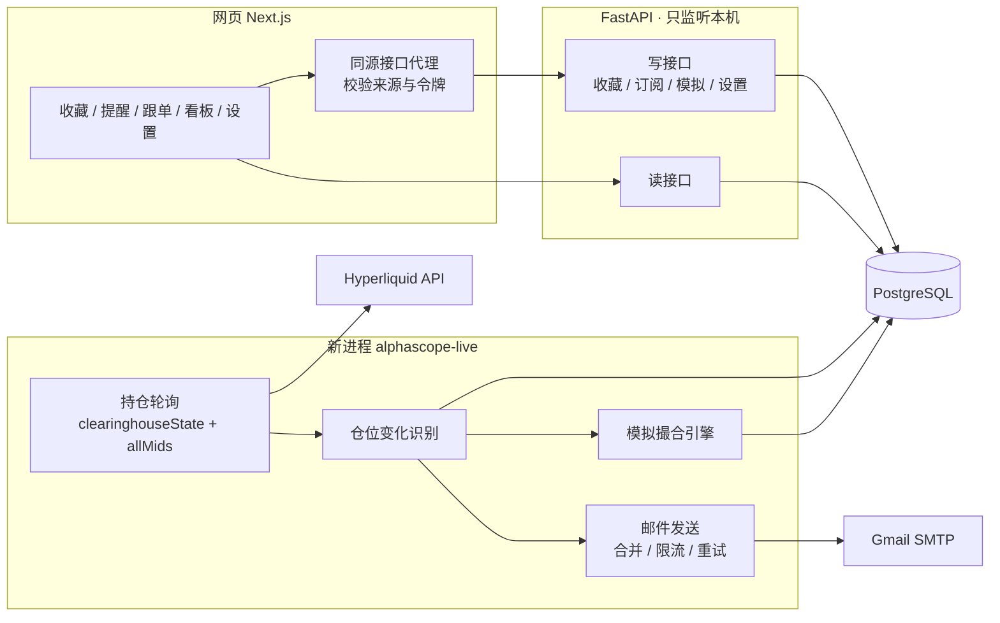

# 10 · 钱包收藏、仓位提醒与模拟跟单

> 目标：把"研究"接到"行动"上。看中的交易员可以分组收藏；他一动仓位就发邮件通知；可以用真实的实时价格、按自己设定的资金同时模拟跟单多个交易员，并在看板上按周期比较结果。模拟跟单的真实表现，也是进入影子跟单前最后一道检验（09 第 7 节 G4/G5）。

## 1. 总体设计

- **单独的 `alphascope-live` 进程**：负责低延迟的轮询、提醒和模拟撮合，和批量采集的 worker 分开。两者互不阻塞，即使批量任务跑上几个小时，提醒也不受影响。
- **限流预算拆分**：每个 IP 每分钟 1,200 权重。批量采集用 35%，实时进程用 15%，合计仍然只占一半，给你同一 IP 上的其他程序留出余量。两个比例都可以配置。
- **单用户模式**：沿用网页登录账号，所有收藏、订阅和模拟都属于这一个账号。数据表预留 `owner` 字段，以后要支持多用户可以直接扩展。

## 2. 钱包收藏（分组 + 自定义名称）

| 功能 | 设计 |
|---|---|
| 收藏入口 | 交易员页、排行榜、节奏榜、波段持仓者、关键价位的每一行都有星标；点击后选择分组，可以同时放进多个分组 |
| 分组 | 自建分组（如"BTC 大周期""山寨短线""观察中"），支持排序、改名、颜色；有一个默认分组 |
| 自定义名称 | 给钱包起别名（如"抄底哥""87k 空军"），全站凡是出现这个地址的地方都优先显示别名，地址作为副标题 |
| 备注与标签 | 自由文本备注、自定义标签 |
| 收藏夹页 | 按分组列出：别名、净值、近 7D / 30D 盈亏、当前主要持仓、最近一次仓位变动、时机评分摘要、是否订阅、是否在模拟跟单 |
| 联动 | 收藏的钱包自动加入成交归档的高优先级队列，保证后续有完整数据 |

## 3. 仓位变动邮件提醒

### 3.1 怎么识别变动

- 实时进程每隔 N 秒（默认 30 秒，可配置）拉一次已订阅钱包的 `clearinghouseState`（权重 2），和上次的持仓做对比，识别出这几类事件：
  - 开仓、加仓、减仓、平仓、反手；
  - 杠杆变化；
  - 强平风险：标记价格距离强平价不到 X%。
- **预算**：60 个订阅钱包每 30 秒一轮，约 240 权重 / 分钟，在实时进程的预算内。
- **局限**：两次轮询之间开了又平的仓位看不到。这种交易本来也来不及跟，邮件里会写明检测间隔。
- **以后可以更快**：订阅数不超过 10 个时，可以改用 WebSocket 推送（Hyperliquid 限制每个 IP 最多推送 10 个地址的成交），延迟能降到秒级。

### 3.2 订阅设置（每个钱包单独设置）

| 设置项 | 说明 |
|---|---|
| 事件类型 | 开仓 / 加仓 / 减仓 / 平仓 / 反手 / 强平风险，可以多选 |
| 最小变动 | 名义价值变化 ≥ $X，或变化 ≥ 仓位的 Y%，过滤掉小额调仓 |
| 币种 | 全部，或只看指定币种（如只看 BTC、ETH） |
| 收件人 | 默认使用设置页里的收件人，也可以按订阅单独指定 |
| 免打扰时段 | 免打扰期间的事件会合并成一封汇总邮件，在时段结束后发送 |

### 3.3 邮件内容

- **标题**：【AlphaScope】抄底哥 开空 BTC $85.2 万 @ 86,940
- **正文**：
  - 变动详情：方向、规模、成交均价、杠杆；
  - 变动后的完整持仓表；
  - 账户净值；
  - 这个钱包在该币上的时机评分摘要；
  - 交易员页链接（带 K 线回放的定位参数）；
  - 如果正在模拟跟这个钱包，附上模拟这边的成交情况。
- **合并**：同一个钱包 60 秒内的多次变动合并成一封，避免拆单造成邮件轰炸。
- **限流**：每小时最多发 N 封，超出的放进汇总邮件。
- **重试**：发送失败会重试，并记录在提醒日志里。

### 3.4 用 Gmail 发信（在设置页配置）

| 项目 | 设计 |
|---|---|
| 方式 | Gmail SMTP：`smtp.gmail.com:587`（STARTTLS）。需要先给谷歌账号开启两步验证，再生成一个**应用专用密码**（16 位），网页设置页填写的是这个密码，不是邮箱登录密码 |
| 设置页 | 填写 SMTP 主机、端口、账号、应用专用密码、发件人名称、默认收件人（可以多个），提供"发送测试邮件"按钮 |
| 密码保存 | 加密存进数据库：密钥放在服务器 `data/secret.key`（权限 600，安装时自动生成）。接口和页面永远不回显密码，只显示"已设置" |
| 发送量 | 免费 Gmail 每天大约能发 500 封，系统会统计当天发送量并在接近上限时提示 |
| 其他服务商 | 同一个设置页也能填 QQ 邮箱、Outlook 或企业邮箱的 SMTP，不绑定 Gmail |

## 4. 模拟跟单（实时价格，多个交易员互不影响）

### 4.1 原则

- **只往前跑，不用未来数据**：从创建模拟的那一刻起，只有系统"看到"交易员的仓位变化之后，才按当时的真实价格模拟成交。
- **每个模拟完全独立**：各自有资金、持仓、成交记录和权益曲线。同一个交易员可以开多个模拟，用来对比不同参数（比如 1 倍和 0.5 倍仓位、延迟 30 秒和 2 分钟）。
- **只是模拟，不下真实订单**，系统也不需要任何私钥。

### 4.2 跟单参数

| 参数 | 选项 | 默认 |
|---|---|---|
| 模拟资金 | 任意金额（USDC） | 10,000 |
| 仓位方式 | ① 按净值比例：他的仓位占他净值多少，你也开到你净值的同样比例 ② 固定倍数：他名义仓位的 k 倍 ③ 每个币固定上限金额 | 按净值比例 |
| 仓位系数 | 在上面的基础上再乘一个系数（如 0.5 倍保守跟） | 1.0 |
| 最大杠杆 | 超过时按比例压缩仓位 | 10× |
| 跟单币种 | 全部 / 指定币种 / 排除某些币种 | 全部 |
| 跟单动作 | 是否跟加仓 / 减仓（也可以只跟开仓和平仓） | 全跟 |
| 执行延迟 | 检测到变化后，再延迟 X 秒成交（模拟人工反应时间） | 0 秒（另有轮询间隔） |
| 已有仓位 | 启动前交易员已持有的仓位默认不追，等他平仓或反手后再跟；可选「同步已有仓位」按当前价格立即开 | 不追 |
| 调仓门槛 | 目标与当前仓位差额小于 X% 或小于最小金额时不动，避免交易员小幅调整带来的来回手续费 | 5% / $10 |
| 手续费 | 吃单费率 | 0.045% |
| 滑点 | 固定基点（按订单簿深度估算留待后续，见 4.5） | 3 bp |
| 资金费 | 按 Hyperliquid 每小时的实际资金费率计入 | 计入 |
| 止损（可选） | 单个模拟回撤超过 X% 时停止跟单、全部平仓 | 关闭 |

### 4.3 撮合方式：目标仓位镜像

1. **计算目标仓位：** 每次轮询拿到交易员的持仓后，按跟单参数算出你在每个币上应该持有的目标仓位。
2. **生成并模拟成交：** 目标仓位和当前模拟仓位的差额，就是要下的单。成交价取：
   - 检测时刻的中间价（allMids）；
   - 加上滑点估算（买单往上加、卖单往下减）；
   - 再加上执行延迟期间的价格变化。
3. **记录每笔成交：** 时间、币种、方向、数量、成交价、手续费、滑点、触发原因（交易员开仓 / 加仓 / …）。
4. **结算资金费：** 每小时按实际资金费率结算。
5. **检查保证金：** 每次轮询都检查保证金，跌破维持保证金就模拟强平。
6. **对账：** 定期把模拟仓位方向和交易员仓位方向做比对，偏差太大时在看板上提示。

### 4.4 数据看板

**单个模拟**
- 权益曲线，与交易员自己同期的资金流调整收益对比；
- 按日 / 周 / 月统计的盈亏表和日历热力图；
- 累计收益、最大回撤、夏普（样本足够才显示）；
- 胜率、盈亏比（按完整仓位周期统计）；
- 按币种的盈亏贡献；
- 成本拆解：手续费、滑点、资金费各吃掉了多少；
- **跟单保留率**：模拟收益 ÷ 交易员同期收益，直接回答"跟得上吗"；
- 成交明细，可以跳到 K 线回放。

**全部模拟的组合看板**
- 合计权益和盈亏；
- 各模拟按周期排名；
- 模拟之间的收益相关性：都在同一个方向上就不算分散；
- 同时持仓的方向集中度。

**周期切换**：今天 / 7 天 / 30 天 / 全部 / 自定义。

### 4.5 实现情况与限制（2026-11）

- **引擎**：`backend/app/sim/engine.py`，由实时进程（`alphascope-live`）每轮调用；被跟随的钱包自动加入轮询名单（不需要订阅邮件）。每轮顺序：结算资金费（整点）→ 用本轮中间价检查强平（价格跳动先于调仓）→ 按目标仓位下单（或进入延迟队列）→ 回撤止损 / 手动停止 → 记录权益。
- **强平**：维持保证金 = 名义价值 ÷ (2 × 该币最大杠杆)，最大杠杆每小时从 `metaAndAssetCtxs` 刷新；净值跌破即按本轮价格全部平仓并停止。
- **滑点**：目前是相对中间价的固定基点。按 `l2Book` 深度估算需要每个币每轮多一次请求，等模拟数量多起来、确有需要再加。
- **交易员收益**：用他的账户净值变化计算，**包含出入金**，页面上标明「仅作参照」；保留率在交易员波动小于 0.5% 时不计算。改成资金流调整收益需要实时读取出入金记录，后续再做。
- **周期统计**：一个周期 = 某币从空仓到再次空仓，反手拆成两个周期，手续费按数量分摊到平仓和开仓两边；盈亏已扣手续费和资金费。
- **尚未实现**：夏普、自定义周期、同时持仓的方向集中度、成交跳转 K 线回放。看板提供 24 小时 / 7 天 / 30 天 / 全部、每日盈亏日历和按周合计、模拟之间每日收益相关性（至少 5 个共同日）。

## 5. 数据表（迁移 0006 收藏、0007 提醒、0008 模拟跟单）

| 表 | 说明 |
|---|---|
| `watch_group` | 分组：名称、颜色、排序、owner |
| `watch_item` | 收藏：wallet_id、group_id、别名、备注、标签、创建时间；唯一键 (group, wallet) |
| `wallet_alias` | 每个钱包一个全局别名（全站显示用） |
| `app_setting` | 键值配置：SMTP 主机 / 端口 / 账号 / 加密密码 / 发件人 / 默认收件人、轮询间隔、限流 |
| `alert_subscription` | 订阅：钱包、事件类型、最小变动、币种、收件人、免打扰、启用 |
| `live_position` | 实时进程对每个被监控钱包最近一次看到的持仓（用于对比） |
| `position_event` | 识别出的仓位事件：时间、钱包、币种、类型、变化前后的仓位、价格 |
| `notification` | 邮件发送记录：关联的事件、收件人、状态、重试次数、错误 |
| `copy_sim` | 模拟：名称、跟随的钱包、资金、仓位方式与系数、最大杠杆、币种过滤、延迟、费率、滑点模型、状态（运行 / 暂停 / 停止）、开始时间 |
| `sim_position` | 模拟当前持仓：币种、数量、均价、开仓时间、最近一轮的中间价 |
| `sim_trade` | 模拟成交：时间、币种、方向、数量、价格、手续费、滑点、资金费、触发事件 |
| `sim_equity` | 权益快照（有成交时记录，否则每 5 分钟一次），含交易员同时刻的账户净值，用于曲线和周期统计 |

## 6. 安全

- **写操作走同源代理**：浏览器只访问网页端口，网页再在服务器内部转发到 API（API 仍然只监听本机）。写接口会校验请求来源（Origin）和一个防伪令牌，防止其他网站借用你浏览器里的登录状态，偷偷改你的收藏、订阅或设置。
- **SMTP 密码**：加密保存，密钥只在服务器上，任何接口都不会返回明文。
- **提醒内容**：只包含公开的链上数据。

## 7. 研发计划

| 步骤 | 内容 | 工作量 | 依赖 |
|---|---|---|---|
| S0 ✅ | 复制按钮在 http 下失效的修复 | 已完成 | — |
| S1 ✅ | 收藏：分组、别名、备注、标签；全站星标与别名显示；收藏夹页；收藏钱包优先归档 | 2–3 天 | 写接口与同源代理 |
| S2 ✅ | 实时进程：持仓轮询与变化识别；订阅设置；SMTP 设置页与测试邮件；邮件合并、限流、重试；提醒日志 | 4–5 天 | S1 |
| S3 ✅ | 模拟跟单引擎：目标仓位镜像、滑点 / 手续费 / 资金费、保证金与强平、暂停 / 停止；模拟管理页 | 约 1 周 | S2 的轮询 |
| S4 ✅ | 看板：单个模拟和组合看板、按周期统计、跟单保留率、相关性 | 4–5 天 | S3 |

部署：沿用一键更新，新增 `alphascope-live` 服务，更新脚本会自动安装和启动。

## 8. 本轮新增的创新机会

| 名称 | 价值 | 成本 | 优先级 |
|---|---|---|---|
| **共识提醒** | 收藏的多个高评分交易员在短时间内同向开仓同一个币时，单独发一封提醒，这比单个人的动作更有参考价值 | 低（复用仓位事件） | 高 |
| **评分变化提醒** | 收藏的钱包出现 Alpha 衰减、时机评分显著下降、杠杆突然放大时提醒，防止继续跟一个已经变差的人 | 低 | 中 |
| **历史回放式模拟** | 用已归档的成交，按同样的跟单参数回放过去几个月，马上看到"如果 7 月就开始跟他会怎样"，不必等前瞻数据慢慢积累（09 T4 的一部分） | 中 | 高 |
| **跟单参数对照实验** | 同一个交易员一键开 3 个模拟（不同仓位系数和延迟），自动对比，找到最适合跟他的参数 | 低（复用多模拟） | 中 |
